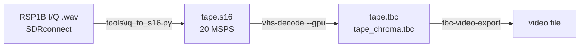
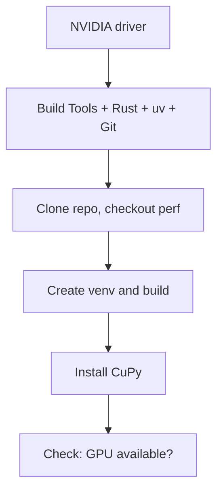

# Running vhs-decode-gpu natively on Windows

Build and run the `perf` branch directly on Windows, with no WSL in between.

## Why native

WSL2 adds overhead on exactly the things this decoder leans on:

- **CPU ↔ GPU copies:** these measured only ~1.4 GB/s (3.4 GB/s pinned) under WSL2.
- **Disk:** files under `/mnt/c` cross a slow file-system bridge.
- **Memory:** fresh memory is expensive to touch inside the WSL VM.

Native Windows should avoid all three. This hasn't been benchmarked yet, so time a decode before and after.

## The workflow



## One-time setup



### 1. Tools

Run these in **PowerShell**:

```powershell
winget install --id Git.Git
winget install --id astral-sh.uv
winget install --id Rustlang.Rustup
winget install --id Microsoft.VisualStudio.2022.BuildTools --override "--quiet --wait --add Microsoft.VisualStudio.Workload.VCTools --includeRecommended"
```

- Rust and the C extensions need the **C++ Build Tools** (MSVC). That's what the last line installs.
- **Close and reopen PowerShell** afterwards, so `cargo` and `uv` are on PATH.
- Update the NVIDIA driver, then run `nvidia-smi` and note the **CUDA Version** shown at the top right.

### 2. Build

```powershell
git clone https://github.com/hkazmi/vhs-decode-gpu.git   # or git@github.com:... with an SSH key
cd vhs-decode-gpu
git checkout perf

uv venv --python 3.12 .venv
uv pip install --python .venv\Scripts\python.exe -e ".[test]" --config-settings editable_mode=compat
```

This compiles the Rust module and the Cython modules. Keep `editable_mode=compat`: without it the commands can't find the Rust module.

### 3. GPU support

Pick the CuPy package that matches the CUDA Version from `nvidia-smi`:

```powershell
# CUDA 13.x
uv pip install --python .venv\Scripts\python.exe "cupy-cuda13x[ctk]"
# CUDA 12.x
uv pip install --python .venv\Scripts\python.exe "cupy-cuda12x[ctk]"
```

### 4. Check

```powershell
.venv\Scripts\python.exe -c "import vhsd_rust, vhsdecode.sync; from vhsdecode import gpu; print(gpu.gpu_available())"
```

You should see `(True, None)`. If not, the message says why.

## Decoding a capture

```powershell
# 1. I/Q WAV -> .s16 (centre frequency is read from the _3450000HZ file name)
.venv\Scripts\python.exe tools\iq_to_s16.py SDRconnect_IQ_..._3450000HZ.wav -o tape.s16

# 2. .s16 -> TBC (fastest settings)
.venv\Scripts\vhs-decode.exe --gpu --no_resample --pal --tf vhs -f 20 --threads 4 tape.s16 tape
```

- Leave out `--no_resample` for the well-tested default. It's slower, but the picture looked the same on our test.
- Leave out `--gpu` to stay on the CPU.
- The first `--gpu` run pauses about 20 s while CUDA kernels compile. Later runs are fast.

### 3. TBC → video

Use `tbc-video-export.exe` from the vhs-decode / tbc-tools Windows releases:

```powershell
tbc-video-export.exe --ffmpeg-profile x264_web tape.tbc
```

`x264_web` makes a small H.264 file for viewing. Leave the profile out for the default lossless archival export (FFV1).

## Keep it fast

| Do | Why |
|---|---|
| Keep captures and output on a local NVMe drive | A decode writes about 4 GB of TBC per minute of tape |
| Exclude the capture folder from Defender: `Add-MpPreference -ExclusionPath D:\captures` (admin) | Real-time scanning slows big file writes |
| Use `--threads 4` | More threads made it slower in testing |
| Use the "High performance" power plan | Avoids CPU clock dips |

## If something goes wrong

| Symptom | Fix |
|---|---|
| `cargo` / `uv` not found | Reopen PowerShell after installing |
| `link.exe` not found, or MSVC errors | Re-run the Build Tools install (C++ workload) |
| Build error mentioning `distutils` | Run `uv pip install --python .venv\Scripts\python.exe "setuptools<82" setuptools-rust setuptools_scm cython numpy`, then repeat the build with `--no-build-isolation` added |
| `No module named vhsd_rust` | The build was done without `--config-settings editable_mode=compat`; rebuild with it |
| `GPU decoding disabled: ...` | The message names the cause: CuPy missing, driver too old, or an option the GPU path doesn't support |
| CuPy DLL / CUDA errors | The CuPy package doesn't match the driver; reinstall the matching `cupy-cuda12x` / `cupy-cuda13x` |
